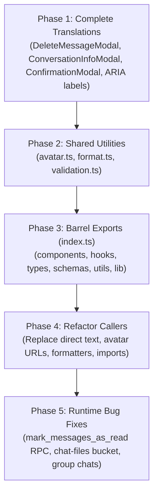

# TalkHub Codebase Review & Audit (Version 3)
**Date:** November 20, 2026  
**Reference Documents:** [CODEBASE_REVIEW.md](file:///Users/pc-react/Documents/code_review/talkhub/CODEBASE_REVIEW.md), [CODEBASE_REVIEW_V2.md](file:///Users/pc-react/Documents/code_review/talkhub/CODEBASE_REVIEW_V2.md)  
**Evaluated Branch / Commit:** `main` (`6324853`)

---

## 1. Executive Summary & Progress Audit

Following the evaluations in V1 and V2, recent commits (`9bc81ed`, `89a29d1`, `f568532`, `a403108`, `6324853`) cleaned up accidental root files (`touch ARCHITECTURE.md`, `color.ts`) and completed the component split for `MessageInput.tsx` (`AttachmentPreviewList.tsx` and `EmojiPickerPopover.tsx` are now populated).

This Version 3 audit specifically focuses on:
1. **Hardcoded Direct Text Strings & Missing Translations (`useTranslations`)**: Identifying raw English text across modal, chat, and message components that bypass `next-intl` localization.
2. **Duplicated Functionality & Logic**: Highlighting logic implemented multiple times in parallel across components, hooks, and utility modules without a single source of truth.
3. **Code Structure & Barrel Export Architecture (`index.ts`)**: Analyzing the import graph across `src/` to demonstrate how introducing standard `index.ts` barrel files across components, UI, modals, icons, hooks, types, schemas, lib, and utils streamlines developer ergonomics and eliminates brittle deep relative imports.

### Progress Matrix Since V2

| Area / Recommendation from V2 | Status | Current State |
| :--- | :---: | :--- |
| **Accidental Root `touch ARCHITECTURE.md`** | ✅ **RESOLVED** | Removed in commit `9bc81ed`. |
| **Unused `color.ts` File** | ✅ **RESOLVED** | Removed in commit `89a29d1`. |
| **Empty 0-byte Files in `message-input/`** | ✅ **RESOLVED** | `AttachmentPreviewList.tsx` & `EmojiPickerPopover.tsx` are now implemented and wired into `MessageInput.tsx`. |
| **Hardcoded Direct Text Strings** | ❌ **UNRESOLVED** | `DeleteMessageModal.tsx` (e.g. line 63 `"Delete for me"`), `ConversationInfoModal.tsx`, `ConfirmationModal.tsx`, `MessageImageGallery.tsx`, etc., use raw English text instead of `next-intl`. |
| **RPC Name Mismatch** (`mark_messages_as_read/delivered`) | ❌ **UNRESOLVED** | `ChatScreen.tsx` (line 138) still calls non-existent `mark_conversation_messages_read`. |
| **Storage Bucket Name Mismatch** (`chat-attachments` vs `chat-files`) | ❌ **UNRESOLVED** | `useChat.ts` still targets `"chat-attachments"`, whereas SQL schema creates `"chat-files"`. |
| **Group Chat UI Visibility in Sidebar** | ❌ **UNRESOLVED** | `ChatSidebar.tsx` still maps over `filteredUsers` with `!c.is_group`. Group chats remain invisible in sidebar threads. |
| **Create Group Button in Modal** | ❌ **UNRESOLVED** | `CreateGroupModal.tsx` button remains `disabled={true}` with commented handlers. |
| **Missing Barrel Exports (`index.ts`)** | ❌ **UNRESOLVED** | Only `src/screen/chat/index.ts` exists. All other 12 directories require deep relative paths. |
| **Duplicated Business & Utility Logic** | ❌ **UNRESOLVED** | Avatar generation (5x), file size formatting (3x), date formatting (3x), Zod error mapping (2x), and manual UUID byte-shifting. |

---

## 2. Hardcoded Direct Text Strings (Missing Translations / `useTranslations`) Audit

A significant number of components still render raw, untranslated English strings or hardcode accessibility attributes (`aria-label`, `title`) directly in JSX rather than reading from `messages/en.json` via `next-intl`'s `useTranslations()`.

---

### 1. `DeleteMessageModal.tsx` (Complete Lack of Translations)
* **What's wrong:**
  [DeleteMessageModal.tsx](file:///Users/pc-react/Documents/code_review/talkhub/src/components/chat/message/DeleteMessageModal.tsx) does not import `useTranslations` at all. Every user-facing button and label is hardcoded in English:
  - **Line 48:** `Delete this message?` (modal title)
  - **Line 52:** `This action can’t be undone.` (modal description)
  - **Line 63:** `Delete for me` (primary action button)
  - **Line 72:** `Delete for everyone` (destructive action button)
  - **Line 77:** `You can only delete someone else’s message for yourself.` (helper note)
* **Why it matters:**
  If the application is localized to Spanish, French, German, or Hindi, this confirmation dialog will remain entirely in English, breaking the multilingual experience at a critical data-deletion juncture.
* **How to improve:**
  1. Add a `"DeleteMessageModal"` block to `messages/en.json`:
     ```json
     "DeleteMessageModal": {
       "title": "Delete this message?",
       "description": "This action can’t be undone.",
       "deleteForMe": "Delete for me",
       "deleteForEveryone": "Delete for everyone",
       "deleteRestrictionNote": "You can only delete someone else’s message for yourself."
     }
     ```
  2. In `DeleteMessageModal.tsx`:
     ```tsx
     import { useTranslations } from "next-intl";

     export default function DeleteMessageModal(...) {
       const t = useTranslations("screen.chat.DeleteMessageModal");
       // ...
       <h2>{t("title")}</h2>
       <p>{t("description")}</p>
       <button ...>{t("deleteForMe")}</button>
       <button ...>{t("deleteForEveryone")}</button>
       <p>{t("deleteRestrictionNote")}</p>
     ```
* **Affected files:**
  - [DeleteMessageModal.tsx](file:///Users/pc-react/Documents/code_review/talkhub/src/components/chat/message/DeleteMessageModal.tsx#L48-L79)
  - [messages/en.json](file:///Users/pc-react/Documents/code_review/talkhub/messages/en.json)

---

### 2. `ConversationInfoModal.tsx` (Hardcoded Contact Headers & Labels)
* **What's wrong:**
  [ConversationInfoModal.tsx](file:///Users/pc-react/Documents/code_review/talkhub/src/components/modal/ConversationInfoModal.tsx) contains direct strings with no translation hooks:
  - **Line 64:** `Contact Information`
  - **Line 70:** `aria-label="Close"`
  - **Line 97:** `Full Name`
  - **Line 99:** `Not provided`
  - **Line 109:** `Phone Number`
  - **Line 111:** `Not provided`
* **Why it matters:**
  Users viewing contact details receive raw English strings regardless of selected locale.
* **How to improve:**
  Add a `"ConversationInfoModal"` section to `messages/en.json` and use `const t = useTranslations("screen.chat.ConversationInfoModal")`:
  ```json
  "ConversationInfoModal": {
    "title": "Contact Information",
    "close": "Close",
    "fullName": "Full Name",
    "phoneNumber": "Phone Number",
    "notProvided": "Not provided"
  }
  ```
* **Affected files:**
  - [ConversationInfoModal.tsx](file:///Users/pc-react/Documents/code_review/talkhub/src/components/modal/ConversationInfoModal.tsx#L64-L112)
  - [messages/en.json](file:///Users/pc-react/Documents/code_review/talkhub/messages/en.json)

---

### 3. `ConfirmationModal.tsx` (Hardcoded Action Labels)
* **What's wrong:**
  In [ConfirmationModal.tsx](file:///Users/pc-react/Documents/code_review/talkhub/src/components/modal/ConfirmationModal.tsx):
  - **Line 60:** `aria-label="Close modal"`
  - **Line 83:** `Cancel`
* **Why it matters:**
  Generic confirmation modals (like logout or destructive prompts) display a hardcoded English `"Cancel"` button.
* **How to improve:**
  Add default fallback translation or accept translated labels from the caller using `t("cancel")`.
* **Affected files:**
  - [ConfirmationModal.tsx](file:///Users/pc-react/Documents/code_review/talkhub/src/components/modal/ConfirmationModal.tsx#L60-L84)

---

### 4. `MessageContextMenu.tsx` (Hardcoded Titles & ARIA Attributes)
* **What's wrong:**
  In [MessageContextMenu.tsx](file:///Users/pc-react/Documents/code_review/talkhub/src/components/chat/message/MessageContextMenu.tsx):
  - **Line 165:** `title="More options"`
  - **Line 168:** `aria-label="More message options"`
  - **Line 177:** `title="Copy message"`
  - **Line 178:** `aria-label="Copy message"`
* **Why it matters:**
  Screen readers and mouse tooltips speak and render untranslated English text to users on localized interfaces.
* **How to improve:**
  Use keys under `"MessageItem"` namespace: `t("moreOptions")`, `t("copyMessage")`.
* **Affected files:**
  - [MessageContextMenu.tsx](file:///Users/pc-react/Documents/code_review/talkhub/src/components/chat/message/MessageContextMenu.tsx#L165-L178)
  - [messages/en.json](file:///Users/pc-react/Documents/code_review/talkhub/messages/en.json)

---

### 5. `MessageImageGallery.tsx` (Hardcoded Accessibility Labels)
* **What's wrong:**
  In [MessageImageGallery.tsx](file:///Users/pc-react/Documents/code_review/talkhub/src/components/chat/message/MessageImageGallery.tsx):
  - **Line 197:** `aria-label="Download image"`
  - **Line 237:** `aria-label={`View image ${index + 1} of ${images.length}`}`
  - **Line 338:** `aria-label="Image gallery"`
  - **Line 367:** `aria-label="Download current image"`
  - **Line 377:** `aria-label="Close gallery"`
  - **Line 391:** `aria-label="Previous image"`
  - **Line 417:** `aria-label="Next image"`
  - **Line 435:** `aria-label={`Show image ${index + 1}`}`
* **Why it matters:**
  Violates accessibility standards in localized applications because assistive technologies announce English labels.
* **How to improve:**
  Define parameterized ICU message strings in `messages/en.json` (e.g. `"viewImageN": "View image {current} of {total}"`, `"previousImage": "Previous image"`, etc.) and invoke them via `t("previousImage")`.
* **Affected files:**
  - [MessageImageGallery.tsx](file:///Users/pc-react/Documents/code_review/talkhub/src/components/chat/message/MessageImageGallery.tsx)
  - [messages/en.json](file:///Users/pc-react/Documents/code_review/talkhub/messages/en.json)

---

### 6. `useConversations.ts` & `UserListItem.tsx` (Hardcoded Deleted Message State Strings)
* **What's wrong:**
  In [useConversations.ts](file:///Users/pc-react/Documents/code_review/talkhub/src/hooks/useConversations.ts#L127-L131):
  ```ts
  last_message: isDeletedForEveryone
    ? "This message was deleted"
    : isDeletedForMe
      ? "You deleted this message"
      : conv.last_message_content || "",
  ```
  And in [UserListItem.tsx](file:///Users/pc-react/Documents/code_review/talkhub/src/components/chat/UserListItem.tsx#L72-L76):
  ```ts
  if (
    lastMessage === "This message was deleted" ||
    lastMessage === "You deleted this message"
  ) {
    return t("deletedMessagePlaceholder");
  }
  ```
* **Why it matters:**
  Business logic in the hook injects raw English prose into the conversation object. Then the UI component performs string equality checks against hardcoded English strings to decide whether to show a translated placeholder. If either string changes slightly, this check breaks silently.
* **How to improve:**
  The hook should maintain state enums (e.g., `is_deleted: boolean, is_deleted_for_everyone: boolean, is_deleted_for_me: boolean`) and let the presentation layer resolve the translated text via `t("deletedMessagePlaceholder")` and `t("youDeletedMessage")`.
* **Affected files:**
  - [useConversations.ts](file:///Users/pc-react/Documents/code_review/talkhub/src/hooks/useConversations.ts)
  - [UserListItem.tsx](file:///Users/pc-react/Documents/code_review/talkhub/src/components/chat/UserListItem.tsx)

---

## 3. Duplicated Logic & Functionalities Audit

Several core algorithms and formatting utilities are reimplemented independently across multiple files instead of utilizing a shared utility module.

---

### 1. UI Avatar URL Generation (Duplicated in 5 Files)
* **What's wrong:**
  The fallback avatar URL pattern `https://ui-avatars.com/api/?name=${encodeURIComponent(name)}&background=8b34d7&color=fff` is hardcoded across five separate files:
  1. `src/components/chat/UserListItem.tsx` (line 33)
  2. `src/components/chat/EditProfileModal.tsx` (line 98)
  3. `src/components/chat/CreateGroupModal.tsx` (line 133)
  4. `src/components/modal/ConversationInfoModal.tsx` (line 29)
  5. `src/hooks/useConversations.ts` (lines 100–102)
* **Why it matters:**
  - Inconsistent branding: If the avatar background color (`8b34d7`), text color (`fff`), font size, or image provider changes, all 5 locations must be tracked down and edited manually.
  - Risk of discrepancies: Minor differences in fallback defaults (`"User"` vs `name` vs empty string) lead to rendering inconsistencies between the chat list, header, group modal, and profile editor.
* **How to improve:**
  Create a single helper `getAvatarUrl(name?: string | null, avatarUrl?: string | null): string` in `src/utils/avatar.ts`:
  ```ts
  // src/utils/avatar.ts
  const DEFAULT_AVATAR_BG = "8b34d7";
  const DEFAULT_AVATAR_COLOR = "fff";

  export function getAvatarUrl(name?: string | null, avatarUrl?: string | null): string {
    if (avatarUrl?.trim()) {
      return avatarUrl;
    }
    const displayName = name?.trim() || "User";
    return `https://ui-avatars.com/api/?name=${encodeURIComponent(displayName)}&background=${DEFAULT_AVATAR_BG}&color=${DEFAULT_AVATAR_COLOR}`;
  }
  ```
* **Affected files:**
  - `src/components/chat/UserListItem.tsx`
  - `src/components/chat/EditProfileModal.tsx`
  - `src/components/chat/CreateGroupModal.tsx`
  - `src/components/modal/ConversationInfoModal.tsx`
  - `src/hooks/useConversations.ts`

---

### 2. File Size Formatting `formatFileSize` (Duplicated in 3 Files)
* **What's wrong:**
  A helper function calculating human-readable file sizes (converting bytes to `Bytes`, `KB`, `MB`, `GB`) is independently defined in:
  1. `src/components/chat/message-input/AttachmentPreviewList.tsx` (lines 16–23)
  2. `src/components/chat/message/MessageAttachment.tsx` (lines 13–21)
  3. `src/components/chat/message/MessageImageGallery.tsx` (lines 18–26)
* **Why it matters:**
  - Redundant bytes calculation and unit array allocations on every component render.
  - Inconsistent decimal rounding (`toFixed(1)` vs `Math.round`) and null/undefined handling.
* **How to improve:**
  Create a standardized formatter in `src/utils/format.ts`:
  ```ts
  // src/utils/format.ts
  export function formatFileSize(bytes?: number | null): string {
    if (!bytes || bytes <= 0) return "";
    const units = ["Bytes", "KB", "MB", "GB", "TB"];
    const k = 1024;
    const i = Math.floor(Math.log(bytes) / Math.log(k));
    const size = parseFloat((bytes / Math.pow(k, i)).toFixed(1));
    return `${size} ${units[i]}`;
  }
  ```
* **Affected files:**
  - `src/components/chat/message-input/AttachmentPreviewList.tsx`
  - `src/components/chat/message/MessageAttachment.tsx`
  - `src/components/chat/message/MessageImageGallery.tsx`

---

### 3. Date & Time Formatting (Duplicated across 3 Components/Hooks)
* **What's wrong:**
  Time formatting using `toLocaleTimeString` with 2-digit hour/minute options is repeated in:
  1. `src/components/chat/UserListItem.tsx` (lines 37–59, custom date comparison logic)
  2. `src/components/chat/MessageItem.tsx` (line 30)
  3. `src/hooks/useConversations.ts` (lines 137–141)
* **Why it matters:**
  - In `useConversations.ts`, the hook formats `conv.last_message_at` into `last_message_time` string using empty locale options `[]`, while `UserListItem.tsx` receives `lastMessageAt` and re-formats it using `locale` from `useLocale()`. This double formatting wastes CPU cycles and creates locale discrepancies.
* **How to improve:**
  Centralize time and date relative formatting into `src/utils/format.ts`:
  ```ts
  export function formatMessageTime(dateString?: string | null, locale: string = "en"): string {
    if (!dateString) return "";
    const date = new Date(dateString);
    if (isNaN(date.getTime())) return "";
    return date.toLocaleTimeString(locale, {
      hour: "2-digit",
      minute: "2-digit",
    });
  }
  ```
* **Affected files:**
  - `src/components/chat/UserListItem.tsx`
  - `src/components/chat/MessageItem.tsx`
  - `src/hooks/useConversations.ts`

---

### 4. Zod Issue Mapping Boilerplate in `validation.ts`
* **What's wrong:**
  In `src/utils/validation.ts`, `validation()` (for signup) and `loginValidation()` (for login) duplicate identical 15-line issue mapping routines:
  ```ts
  // Repeated in both functions:
  if (!result.success) {
    const errors: Partial<Record<keyof T, string>> = {};
    const issues = result.error.issues;
    issues.forEach((issue) => {
      const field = issue.path[0] as keyof T;
      if (field && !errors[field]) {
        errors[field] = issue.message;
      }
    });
    return errors;
  }
  ```
* **Why it matters:**
  - Adding future forms (e.g. edit profile, create group, reset password) requires duplicating the same error parsing logic every time.
  - Type casting `issue.path[0] as keyof T` is prone to runtime errors if nested schema paths are introduced.
* **How to improve:**
  Create a single generic helper `formatZodErrors<T>(result: z.SafeParseReturnType<any, T>)`:
  ```ts
  import { z } from "zod";

  export function formatZodErrors<T>(
    result: z.SafeParseReturnType<unknown, T>,
  ): Partial<Record<keyof T, string>> {
    if (result.success) return {};
    const errors: Partial<Record<keyof T, string>> = {};
    for (const issue of result.error.issues) {
      const field = issue.path[0] as keyof T;
      if (field && !errors[field]) {
        errors[field] = issue.message;
      }
    }
    return errors;
  }

  export function validateWithSchema<T>(
    schema: z.ZodType<T>,
    data: unknown,
    isPartial = false,
  ): Partial<Record<keyof T, string>> {
    const targetSchema = isPartial && "partial" in schema ? (schema as any).partial() : schema;
    return formatZodErrors(targetSchema.safeParse(data));
  }
  ```
* **Affected files:**
  - `src/utils/validation.ts`

---

### 5. Conversation Sorting Logic Duplication
* **What's wrong:**
  Sorting conversations chronologically by `last_message_timestamp` occurs twice:
  1. In `src/hooks/useConversations.ts` (lines 148–156)
  2. In `src/components/chat/ChatSidebar.tsx` (lines 109–119)
* **Why it matters:**
  - The SQL query `get_user_conversations()` already orders threads descending by latest message.
  - Sorting once in the hook and again in `useMemo` in `ChatSidebar.tsx` causes unnecessary re-sorting on every render pass.
* **How to improve:**
  Keep the array sorted at the query layer (`useConversations.ts`), exposing a pre-sorted list, and remove the redundant sort inside `ChatSidebar.tsx`.
* **Affected files:**
  - `src/hooks/useConversations.ts`
  - `src/components/chat/ChatSidebar.tsx`

---

### 6. Manual UUID Byte-Shifting vs Standard `crypto.randomUUID`
* **What's wrong:**
  In `src/hooks/useChat.ts` (lines 400–422), a 23-line function `generateGroupId()` manually allocates a `Uint8Array(16)`, performs bitwise masking (`bytes[6] = (bytes[6] & 0x0f) | 0x40`), slices byte hex strings, and concatenates hyphens:
  ```ts
  function generateGroupId(): string {
    if (typeof crypto.randomUUID === "function") {
      return crypto.randomUUID();
    }
    const bytes = crypto.getRandomValues(new Uint8Array(16));
    bytes[6] = (bytes[6] & 0x0f) | 0x40;
    bytes[8] = (bytes[8] & 0x3f) | 0x80;
    // ... 15 more lines of manual byte concatenation
  }
  ```
* **Why it matters:**
  - Every modern evergreen browser (Chrome 92+, Safari 15.4+, Firefox 95+) and Node.js 16.7+ natively supports `crypto.randomUUID()`.
  - Bundling custom UUID generators inside React hook files introduces unnecessary complexity and potential edge-case entropy bugs.
* **How to improve:**
  Use `crypto.randomUUID()` directly in `useChat.ts`, or extract a standardized ID utility into `src/utils/id.ts`.
* **Affected files:**
  - `src/hooks/useChat.ts`

---

## 4. Code Structure & Barrel Export (`index.ts`) Audit

### Current Architecture Problems

Currently, across the entire project, **only one directory contains an `index.ts` file**:
- `src/screen/chat/index.ts`

Every other folder lacks a public interface, forcing developers to write deep, fragile relative paths like:
```ts
// Brittle and verbose:
import MessageAttachment from "../../components/chat/message/MessageAttachment";
import MessageContextMenu from "../../components/chat/message/MessageContextMenu";
import MessageImageGallery from "../../components/chat/message/MessageImageGallery";
import MessageTextContent from "../../components/chat/message/MessageTextContent";
import DeleteMessageModal from "../../components/chat/message/DeleteMessageModal";
import { useMessages, useSendMessage, useSendAttachment } from "@/src/hooks/useChat";
import { useConversations } from "@/src/hooks/useConversations";
import { useRealtimeMessages } from "@/src/hooks/useRealtimeChat";
```

### Folder Fragmentation
1. **Scattered Modals:** Modals are split across 3 separate folders:
   - `src/components/chat/EditProfileModal.tsx`
   - `src/components/chat/CreateGroupModal.tsx`
   - `src/components/chat/message/DeleteMessageModal.tsx`
   - `src/components/modal/ConversationInfoModal.tsx`
   - `src/components/modal/ConfirmationModal.tsx`
2. **Folder & File Typo:**
   - `src/constant/attechmentFile.ts` (singular `constant`, typo `attechmentFile`). Should be `src/constants/attachments.ts`.
3. **Missing Barrel Files:** 12 primary module folders have no `index.ts`.

---

### Recommended Barrel Architecture

Introducing barrel exports enables concise, maintainable, and clean imports:

```
src/
├── components/
│   ├── index.ts                     # Re-exports all components, UI, chat, modals, icons
│   ├── ui/index.ts                  # Re-exports Button, Input, AlertDialog, etc.
│   ├── chat/
│   │   ├── index.ts                 # ChatWindow, ChatSidebar, ChatHeader, MessageList, MessageInput
│   │   ├── message/index.ts         # MessageAttachment, MessageContextMenu, MessageImageGallery, etc.
│   │   └── message-input/index.ts   # AttachmentPreviewList, EmojiPickerPopover
│   ├── modal/index.ts               # ConversationInfoModal, ConfirmationModal, EditProfileModal, CreateGroupModal
│   └── icons/index.ts               # All SVG icons (MessageIcon, SendIcon, EmojiIcon, etc.)
├── hooks/index.ts                   # All hooks (useChat, useConversations, useRealtimeChat, useAuth, etc.)
├── types/index.ts                   # All TypeScript interfaces and types
├── schemas/index.ts                 # All Zod schemas
├── lib/index.ts                     # Supabase clients, query keys, utils
├── utils/index.ts                   # Avatar, formatters, validation, regex
└── constants/index.ts               # Attachment file configs
```

---

### Clean Import Transformation Examples

#### A. In `src/screen/chat/ChatScreen.tsx`
**Before (Current):**
```ts
import type { ChatConversation, ChatScreenProps } from "@/src/types/chat";
import MessageIcon from "@/src/components/icons/Message";
import ChatWindow from "@/src/components/chat/ChatWindow";
import ChatSidebar from "@/src/components/chat/ChatSidebar";
import { useConversations } from "@/src/hooks/useConversations";
import { useRealtimeMessages } from "@/src/hooks/useRealtimeChat";
import {
  useMessages,
  useSendMessage,
  useSendAttachment,
  useSendImageGroup,
  useCreateDirectConversation,
} from "@/src/hooks/useChat";
```

**After (With Barrel Architecture):**
```ts
import type { ChatConversation, ChatScreenProps } from "@/src/types";
import { ChatSidebar, ChatWindow } from "@/src/components/chat";
import { MessageIcon } from "@/src/components/icons";
import {
  useConversations,
  useRealtimeMessages,
  useMessages,
  useSendMessage,
  useSendAttachment,
  useSendImageGroup,
  useCreateDirectConversation,
} from "@/src/hooks";
```

#### B. In `src/components/chat/MessageItem.tsx`
**Before (Current):**
```ts
import MessageAttachment from "./message/MessageAttachment";
import MessageTextContent from "./message/MessageTextContent";
import MessageContextMenu from "./message/MessageContextMenu";
import DeleteMessageModal from "./message/DeleteMessageModal";
import MessageImageGallery from "./message/MessageImageGallery";
```

**After (With Barrel Architecture):**
```ts
import {
  MessageAttachment,
  MessageContextMenu,
  MessageImageGallery,
  MessageTextContent,
  DeleteMessageModal,
} from "./message";
```

---

### Proposed Barrel File Implementations

#### 1. `src/components/ui/index.ts`
```ts
export * from "./button";
export * from "./input";
export * from "./alert-dialog";
```

#### 2. `src/components/icons/index.ts`
```ts
export { default as EmojiIcon } from "./EmojiIcon";
export { default as FileIcon } from "./FileIcon";
export { default as InfoIcon } from "./InfoIcon";
export { default as MessageIcon } from "./Message";
export { default as MicIcon } from "./MicIcon";
export { default as PhoneIcon } from "./PhoneIcon";
export { default as PlusIcon } from "./PlusIcon";
export { default as SendIcon } from "./SendIcon";
export { default as SparklesIcon } from "./SparklesIcon";
export { default as VideoIcon } from "./VideoIcon";
```

#### 3. `src/components/chat/message/index.ts`
```ts
export { default as MessageAttachment } from "./MessageAttachment";
export { default as MessageContextMenu } from "./MessageContextMenu";
export { default as MessageImageGallery } from "./MessageImageGallery";
export { default as MessageTextContent } from "./MessageTextContent";
export { default as DeleteMessageModal } from "./DeleteMessageModal";
```

#### 4. `src/components/chat/message-input/index.ts`
```ts
export { default as AttachmentPreviewList } from "./AttachmentPreviewList";
export { default as EmojiPickerPopover } from "./EmojiPickerPopover";
```

#### 5. `src/components/chat/index.ts`
```ts
export { default as ChatHeader } from "./ChatHeader";
export { default as ChatSidebar } from "./ChatSidebar";
export { default as ChatWindow } from "./ChatWindow";
export { default as MessageInput } from "./MessageInput";
export { default as MessageItem } from "./MessageItem";
export { default as MessageList } from "./MessageList";
export { default as UserListItem } from "./UserListItem";
export { default as CreateGroupModal } from "./CreateGroupModal";
export { default as EditProfileModal } from "./EditProfileModal";

export * from "./message";
export * from "./message-input";
```

#### 6. `src/components/modal/index.ts`
```ts
export { default as ConfirmationModal } from "./ConfirmationModal";
export { default as ConversationInfoModal } from "./ConversationInfoModal";
export { default as CreateGroupModal } from "../chat/CreateGroupModal";
export { default as EditProfileModal } from "../chat/EditProfileModal";
```

#### 7. `src/components/index.ts`
```ts
export * from "./ui";
export * from "./chat";
export * from "./modal";
export * from "./icons";
```

#### 8. `src/hooks/index.ts`
```ts
export * from "./useChat";
export * from "./useConversations";
export * from "./useDelete";
export * from "./useEditText";
export * from "./useLogin";
export * from "./useLogout";
export * from "./useOnlineUsers";
export * from "./useRealtimeChat";
export * from "./useSignup";
export * from "./useTypingIndicator";
export * from "./useUsers";
```

#### 9. `src/types/index.ts`
```ts
export * from "./chat";
export * from "./form";
export * from "./modals";
export * from "./profile";
```

#### 10. `src/schemas/index.ts`
```ts
export * from "./auth";
```

#### 11. `src/utils/index.ts`
```ts
export * from "./avatar";
export * from "./format";
export * from "./regex";
export * from "./validation";
```

#### 12. `src/lib/index.ts`
```ts
export * from "./utils";
export * from "./queryKeys";
export * from "./supabase/client";
```

---

## 5. Prioritized Action Plan

To establish a clean, scalable code architecture, eliminate duplicated logic, and enforce complete i18n translation coverage, proceed in the following order:



### Action Checklist

1. [ ] **i18n Translations**: Add missing translation keys to `messages/en.json` for:
   - `DeleteMessageModal` (`title`, `description`, `deleteForMe`, `deleteForEveryone`, `deleteRestrictionNote`)
   - `ConversationInfoModal` (`title`, `close`, `fullName`, `phoneNumber`, `notProvided`)
   - `ConfirmationModal` (`cancel`, `closeModal`)
   - `MessageContextMenu` (`moreOptions`, `copyMessage`)
   - `MessageImageGallery` (all ARIA labels: `downloadImage`, `viewImageN`, `closeGallery`, etc.)
2. [ ] **Component Translation Refactor**:
   - Refactor `DeleteMessageModal.tsx` to consume `useTranslations("screen.chat.DeleteMessageModal")`.
   - Refactor `ConversationInfoModal.tsx` to consume `useTranslations("screen.chat.ConversationInfoModal")`.
   - Refactor `UserListItem.tsx` and `useConversations.ts` to stop using hardcoded string equality checks for deleted messages.
3. [ ] **Shared Utils**: Create `src/utils/avatar.ts` with `getAvatarUrl()` and replace all 5 occurrences of `ui-avatars.com`.
4. [ ] **Shared Utils**: Create `src/utils/format.ts` with `formatFileSize()` and `formatMessageTime()`, removing duplicates from `AttachmentPreviewList`, `MessageAttachment`, and `MessageImageGallery`.
5. [ ] **Shared Utils**: Refactor `src/utils/validation.ts` with a generic Zod issue parser `formatZodErrors()`.
6. [ ] **Barrel Architecture**: Create `index.ts` files in:
   - `src/components/ui/index.ts`
   - `src/components/icons/index.ts`
   - `src/components/chat/message/index.ts`
   - `src/components/chat/message-input/index.ts`
   - `src/components/chat/index.ts`
   - `src/components/modal/index.ts`
   - `src/components/index.ts`
   - `src/hooks/index.ts`
   - `src/types/index.ts`
   - `src/schemas/index.ts`
   - `src/utils/index.ts`
   - `src/lib/index.ts`
7. [ ] **Directory Hygiene**: Rename `src/constant/attechmentFile.ts` to `src/constants/attachments.ts` and add `src/constants/index.ts`.
8. [ ] **Import Modernization**: Update `src/screen/chat/ChatScreen.tsx`, `MessageItem.tsx`, and `MessageInput.tsx` to consume the new barrel exports.
9. [ ] **RPC Fixes**: Rename `mark_conversation_messages_read` to `mark_messages_as_read` in `ChatScreen.tsx`.
10. [ ] **Storage Bucket**: Align bucket name in `src/hooks/useChat.ts` from `"chat-attachments"` to `"chat-files"`.
11. [ ] **Group Chat UI**: Re-enable `CreateGroupModal.tsx` and allow group chat display in `ChatSidebar.tsx`.
