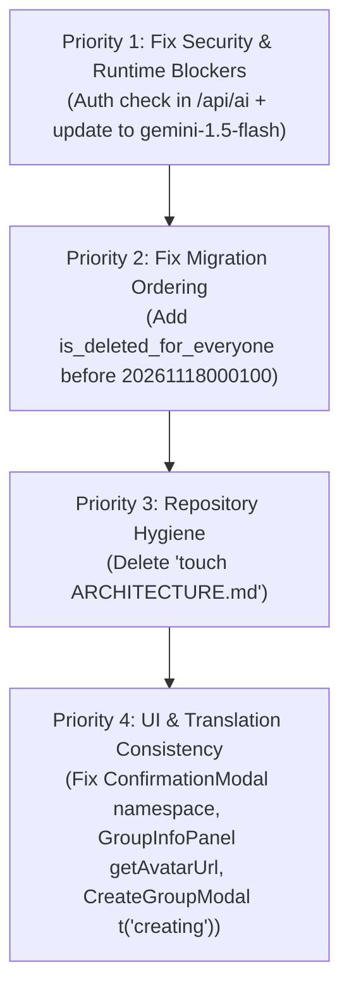

# TalkHub Codebase Review & Audit (Version 4)

**Date:** November 24, 2026  
**Reference Documents:** [CODEBASE_REVIEW.md](file:///Users/pc-react/Documents/code_review/talkhub/CODEBASE_REVIEW.md), [CODEBASE_REVIEW_V2.md](file:///Users/pc-react/Documents/code_review/talkhub/CODEBASE_REVIEW_V2.md), [CODEBASE_REVIEW_V3.md](file:///Users/pc-react/Documents/code_review/talkhub/CODEBASE_REVIEW_V3.md)  
**Evaluated Branch / Commit:** `main` (`27f0135`)

---

## 1. Executive Summary & Progress Audit

Following the recommendations in [CODEBASE_REVIEW_V3.md](file:///Users/pc-react/Documents/code_review/talkhub/CODEBASE_REVIEW_V3.md) and early feedback on V4, the team has pushed commit `27f0135` ("- delete unused files"), which:

- Deleted the 0-byte orphan file `src/components/chat/AIConversationPanel.tsx`.
- Successfully localized `src/components/chat/aiChat/AIChatTools.tsx` with `useTranslations("screen.AiChatTools")`.

Below is the verified status matrix across all audited areas:

### Progress Matrix

| Area / Recommendation                                    |          Status           | Current State & Notes                                                                                                                                      |
| :------------------------------------------------------- | :-----------------------: | :--------------------------------------------------------------------------------------------------------------------------------------------------------- |
| **0-Byte Orphan `AIConversationPanel.tsx`**              |      ✅ **RESOLVED**      | Deleted in commit `27f0135`.                                                                                                                               |
| **`AIChatTools.tsx` Localization**                       |      ✅ **RESOLVED**      | Localized with `screen.AiChatTools` in `messages/en.json` (commit `27f0135`).                                                                              |
| **Barrel Exports Architecture (`index.ts`)**             |      ✅ **RESOLVED**      | Added `index.ts` across `components/`, `ui/`, `chat/`, `message/`, `message-input/`, `modal/`, `icons/`, `hooks/`, `types/`, `schemas/`, `utils/`, `lib/`. |
| **File Size Formatter Consolidation (`formatFileSize`)** |      ✅ **RESOLVED**      | Centralized in `src/utils/format.ts` and consumed cleanly across all attachments and preview components.                                                   |
| **DeleteMessageModal Localization**                      |      ✅ **RESOLVED**      | All buttons and descriptions now use `useTranslations("screen.chat.DeleteMessageModal")`.                                                                  |
| **Deleted Message State Decoupling**                     |      ✅ **RESOLVED**      | `useConversations` exposes boolean flags; `UserListItem` renders `t("deletedMessagePlaceholder")` and `t("youDeletedMessage")`.                            |
| **Group Chat UI & Sidebar Integration**                  |      ✅ **RESOLVED**      | `ChatSidebar.tsx` now combines direct chats and groups into `chatItems`; `CreateGroupModal.tsx` is active and wired.                                       |
| **RPC Name Mismatch** (`mark_conversation_messages_*`)   |      ✅ **RESOLVED**      | Migration `20261121000100_create_group.sql` added `mark_conversation_messages_read` & `delivered`.                                                         |
| **Storage Bucket Name Mismatch**                         |      ✅ **RESOLVED**      | Backend migration `20261027000100_talkhub_schema.sql` creates bucket `'chat-attachments'`.                                                                 |
| **Accidental Root `touch ARCHITECTURE.md`**              |     ❌ **UNRESOLVED**     | 32 KB file with literal name `touch ARCHITECTURE.md` is still in root.                                                                                     |
| **AI Endpoint Security (`/api/ai`)**                     |     ❌ **UNRESOLVED**     | Route has **no authentication check**; anyone can make POST requests and exhaust Gemini quotas.                                                            |
| **Invalid Gemini Model Name (`gemini-3.5-flash`)**       |     ❌ **UNRESOLVED**     | Endpoint uses non-existent `gemini-3.5-flash` instead of `gemini-1.5-flash` or `gemini-2.0-flash`.                                                         |
| **Database Migration Timestamp Dependency**              |     ❌ **UNRESOLVED**     | Migration `20261118000100` references `m.is_deleted_for_everyone` before `20261121000100` adds it. `supabase db reset` will crash.                         |
| **Avatar URL Generator (`getAvatarUrl`)**                | 🟡 **PARTIALLY RESOLVED** | `src/utils/avatar.ts` created, but `AddMembersPanel.tsx` (L136) & `GroupInfoPanel.tsx` (L289, 453, 587) still bypass it.                                   |
| **ConfirmationModal Translation Namespace**              | 🟡 **PARTIALLY RESOLVED** | Global `ConfirmationModal.tsx` (L21) imports `useTranslations("screen.chat.CreateGroupModal")`.                                                            |
| **MessageImageGallery Accessibility i18n**               |     ❌ **UNRESOLVED**     | ARIA labels (`"Download image"`, `"Image gallery"`, `"Previous image"`, `"Next image"`) remain hardcoded in English.                                       |
| **Manual UUID Byte-Shifting in `useChat.ts`**            |     ❌ **UNRESOLVED**     | 23-line `generateGroupId()` bit-shifting routine is still present in `src/hooks/useChat.ts`.                                                               |
| **Zod Error Mapping Boilerplate**                        |     ❌ **UNRESOLVED**     | `validation.ts` still duplicates the identical 15-line issue mapping routine.                                                                              |

---

## 2. Critical Actionable Issues Remaining

### 1. Security Vulnerability: Unauthenticated Public AI Endpoint (`/api/ai`)

- **What's wrong:**
  In [src/app/api/ai/route.ts](file:///Users/pc-react/Documents/code_review/talkhub/src/app/api/ai/route.ts#L14):
  ```ts
  export async function POST(request: NextRequest) {
    try {
      const apiKey = process.env.GEMINI_API_KEY;
      // ... proceeds without verifying auth session
  ```
  The endpoint processes requests and consumes Google Gemini API tokens without verifying whether the incoming caller has a valid authenticated Supabase session.
- **Why it matters:**
  Any anonymous internet user or bot can send automated requests to `POST /api/ai`, consuming paid Gemini API quotas, triggering rate limits, or incurring unexpected billing costs.
- **How to improve:**
  Verify the caller's Supabase session using the server client before invoking the Gemini API:

  ```ts
  import { createClient } from "@/src/lib/supabase/server";

  export async function POST(request: NextRequest) {
    const supabase = await createClient();
    const {
      data: { user },
      error,
    } = await supabase.auth.getUser();

    if (error || !user) {
      return NextResponse.json({ error: "Unauthorized" }, { status: 401 });
    }
    // ... proceed with Gemini API call
  }
  ```

- **Affected files:**
  - `src/app/api/ai/route.ts`

---

### 2. Runtime Failure: Non-Existent Gemini Model Name (`gemini-3.5-flash`)

- **What's wrong:**
  In [src/app/api/ai/route.ts](file:///Users/pc-react/Documents/code_review/talkhub/src/app/api/ai/route.ts#L83):
  ```ts
  const geminiResponse = await fetch(
    "https://generativelanguage.googleapis.com/v1beta/models/gemini-3.5-flash:generateContent",
    ...
  );
  ```
  Google does not have a model named `gemini-3.5-flash`.
- **Why it matters:**
  Every AI reply suggestion or conversation summary request sent through the application fails with a 404 or 400 from Google's endpoint, resulting in a `502 Bad Gateway` returned to the user.
- **How to improve:**
  Change the model endpoint to a supported Gemini model, such as `gemini-1.5-flash` or `gemini-2.0-flash`:
  ```ts
  "https://generativelanguage.googleapis.com/v1beta/models/gemini-1.5-flash:generateContent";
  ```
- **Affected files:**
  - `src/app/api/ai/route.ts`

---

### 3. Database Migration Dependency Ordering Bug (`is_deleted_for_everyone`)

- **What's wrong:**
  - Migration `20261118000100_get_user_conversations.sql` (lines 69, 72, 89) queries column `m.is_deleted_for_everyone`.
  - However, the column is added in migration `20261121000100_sync_missing_production_columns.sql` (timestamped 3 days later).
- **Why it matters:**
  Supabase executes migration files in alphanumeric/chronological order by filename. When executing `supabase db reset` or deploying on a fresh environment, `20261118000100` executes first and crashes with:
  `ERROR: column m.is_deleted_for_everyone does not exist`.
- **How to improve:**
  Prepend the column creation to `20261118000100_get_user_conversations.sql`:
  ```sql
  ALTER TABLE public.messages ADD COLUMN IF NOT EXISTS is_deleted_for_everyone boolean NOT NULL DEFAULT false;
  ```
- **Affected files:**
  - `supabase/migrations/20261118000100_get_user_conversations.sql`

---

### 4. Accidental Root File: `touch ARCHITECTURE.md`

- **What's wrong:**
  A 32 KB file with literal filename `touch ARCHITECTURE.md` remains in the repository root.
- **Why it matters:**
  Clutters the repository root, breaks shell autocompletion, and causes confusion with project documentation.
- **How to improve:**
  Delete the file from git:
  ```bash
  git rm "touch ARCHITECTURE.md"
  ```
- **Affected files:**
  - `touch ARCHITECTURE.md`

---

### 5. Avatar URL Generation Re-introduced in New Panels

- **What's wrong:**
  While `src/utils/avatar.ts` (`getAvatarUrl`) was created, the newly introduced group management panels duplicate raw template literals for `ui-avatars.com`:
  - `src/components/chat/AddMembersPanel.tsx` (line 136)
  - `src/components/chat/GroupInfoPanel.tsx` (lines 289, 453, 587)
- **Why it matters:**
  Defeats the purpose of the shared utility and creates visual inconsistencies if the avatar styling or CDN host changes.
- **How to improve:**
  Import and call `getAvatarUrl(name, user.avatar_url)` from `@/src/utils/avatar`.
- **Affected files:**
  - `src/components/chat/AddMembersPanel.tsx`
  - `src/components/chat/GroupInfoPanel.tsx`

---

### 6. `ConfirmationModal.tsx` Coupled to Wrong Translation Namespace

- **What's wrong:**
  In [src/components/modal/ConfirmationModal.tsx](file:///Users/pc-react/Documents/code_review/talkhub/src/components/modal/ConfirmationModal.tsx#L21):
  ```ts
  const t = useTranslations("screen.chat.CreateGroupModal");
  ```
  `ConfirmationModal` is a global shared modal (used for logout, delete confirmations, etc.), but it imports translations from `CreateGroupModal` to render `{t("cancel")}` and `{t("closeModal")}`!
- **How to improve:**
  Create a shared `"common"` or `"modals.Confirmation"` namespace in `messages/en.json` (e.g. `"cancel": "Cancel"`, `"close": "Close"`).
- **Affected files:**
  - `src/components/modal/ConfirmationModal.tsx`

---

### 7. Remaining Inline Hardcoded Strings

- **`src/components/modal/CreateGroupModal.tsx` line 313:**
  `{createGroup.isPending ? "Creating..." : t("createGroup")}` — `"Creating..."` is hardcoded in English instead of using `t("creating")` (which is already defined in `messages/en.json`!).
- **`src/components/modal/ConversationInfoModal.tsx` line 101:**
  `{userId?.name || "Not provided"}` — `"Not provided"` is hardcoded instead of `t("notProvided")` (which is used for the phone number on line 115).
- **`src/components/chat/GroupInfoPanel.tsx` lines 274, 305:**
  `aria-label="Close group information"` and `aria-label="Change group avatar"` are hardcoded in English.
- **`src/components/chat/message/MessageImageGallery.tsx`:**
  All ARIA attributes (`"Download image"`, `"Image gallery"`, `"Previous image"`, `"Next image"`) remain untranslated English strings.

---

### 8. Manual UUID Generation in `useChat.ts`

- **What's wrong:**
  In `src/hooks/useChat.ts` (lines 417–439), `generateGroupId()` continues to use a 23-line manual byte-shifting implementation instead of `crypto.randomUUID()`.
- **How to improve:**
  Replace with native `crypto.randomUUID()`.
- **Affected files:**
  - `src/hooks/useChat.ts`

---

### 9. Zod Error Mapping Duplication in `validation.ts`

- **What's wrong:**
  In `src/utils/validation.ts`, `validation()` and `loginValidation()` duplicate the identical 15-line issue mapping routine.
- **How to improve:**
  Extract a generic `formatZodErrors<T>()` helper function.
- **Affected files:**
  - `src/utils/validation.ts`

---

## 3. Prioritized Action Plan



### Action Checklist

1. [ ] **AI Security**: Add Supabase session verification (`supabase.auth.getUser()`) in `src/app/api/ai/route.ts` to block unauthenticated public requests.
2. [ ] **AI Model**: Change `gemini-3.5-flash` to `gemini-1.5-flash` in `src/app/api/ai/route.ts`.
3. [ ] **Database Migration**: Ensure `is_deleted_for_everyone` is added to `public.messages` before `20261118000100_get_user_conversations.sql` executes.
4. [ ] **Repo Hygiene**: Remove `touch ARCHITECTURE.md` (`git rm "touch ARCHITECTURE.md"`).
5. [ ] **Avatar Reuse**: Replace `ui-avatars.com` in `AddMembersPanel.tsx` (L136) and `GroupInfoPanel.tsx` (L289, 453, 587) with `getAvatarUrl()`.
6. [ ] **Translations**: Disentangle `ConfirmationModal.tsx` from `screen.chat.CreateGroupModal` by giving it a dedicated or common namespace.
7. [ ] **Inline String Cleanup**: Use `t("creating")` in `CreateGroupModal.tsx:L313` and `t("notProvided")` in `ConversationInfoModal.tsx:L101`.
8. [ ] **Code Hygiene**: Replace manual `generateGroupId()` with `crypto.randomUUID()` in `src/hooks/useChat.ts`.
