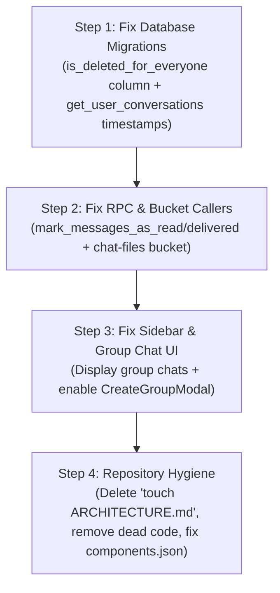

# TalkHub Codebase Review & Audit (Version 2)

**Date:** November 18, 2026  
**Reference Document:** [CODEBASE_REVIEW.md](file:///Users/pc-react/Documents/code_review/talkhub/CODEBASE_REVIEW.md)  
**Evaluated Branch / Commit:** `main` (`e40342e`)

---

## 1. Executive Summary & Progress Audit

Recent pull requests (`#2`, `#3`, `#4`) made significant headway addressing several architectural and structural issues identified in [CODEBASE_REVIEW.md](file:///Users/pc-react/Documents/code_review/talkhub/CODEBASE_REVIEW.md). However, **several critical runtime bugs from V1 remain unfixed**, and **a few new regressions were introduced** in the migration and component layers.

### Progress Matrix

| Area / Recommendation from V1                                         |          Status           | Notes                                                                                                                 |
| :-------------------------------------------------------------------- | :-----------------------: | :-------------------------------------------------------------------------------------------------------------------- |
| **RPC Name Mismatch** (`mark_conversation_messages_read/delivered`)   |     ❌ **UNRESOLVED**     | Still calls `mark_conversation_messages_read` & `mark_conversation_messages_delivered`. Still fails at runtime.       |
| **Storage Bucket Name Mismatch** (`chat-attachments` vs `chat-files`) |     ❌ **UNRESOLVED**     | Frontend still targets `"chat-attachments"`, SQL schema configures `"chat-files"`.                                    |
| **Missing Attachment & Phone Columns in DB**                          |      ✅ **RESOLVED**      | Added via migration `20261117000100_fix_missing_chat_features.sql`.                                                   |
| **Missing Group RPC & Message DELETE RLS**                            |      ✅ **RESOLVED**      | Added `create_group_conversation` RPC and sender DELETE policy in SQL.                                                |
| **Group Chat Creation in UI**                                         |     ❌ **UNRESOLVED**     | `CreateGroupModal.tsx` button remains `disabled={true}`, handlers still commented out.                                |
| **In-Memory Message Fetching in `useConversations`**                  | 🟡 **PARTIALLY RESOLVED** | Added `get_user_conversations()` SQL RPC, but omitted delivered/read timestamps and depends on an unmigrated column.  |
| **Sidebar Omits Group Conversations**                                 |     ❌ **UNRESOLVED**     | `ChatSidebar.tsx` still iterates over `filteredUsers` with `!c.is_group`. Group chats are invisible.                  |
| **Unfiltered Global Realtime Message Listener**                       |      ✅ **RESOLVED**      | `useRealtimeConversations` now dynamically subscribes only to conversation IDs the user belongs to.                   |
| **Typing Indicator Hook Re-render Thrashing**                         |      ✅ **RESOLVED**      | Memoized Supabase client with `useMemo` in `useTypingIndicator.ts`.                                                   |
| **`EditProfileModal` Query Key Mismatch**                             |      ✅ **RESOLVED**      | Uses shared `QUERY_KEYS.users` via `src/lib/queryKeys.ts`.                                                            |
| **Component Decomposition (`MessageItem.tsx`)**                       |      ✅ **RESOLVED**      | Split into subcomponents in `src/components/chat/message/`.                                                           |
| **Component Decomposition (`MessageInput.tsx`)**                      |     ❌ **UNRESOLVED**     | Still 563 lines. Created 0-byte empty files `AttachmentPreviewList.tsx` and `EmojiPickerPopover.tsx`.                 |
| **Path Alias & Directory Consolidation**                              | 🟡 **PARTIALLY RESOLVED** | Root `./components` & `./lib` moved to `./src/`, but `components.json` was not updated to reflect `./src/`.           |
| **Dead Files & Repository Cleanup**                                   | 🟡 **PARTIALLY RESOLVED** | Deleted `color.ts`, `chat.store.ts`, unused schemas, and zip; but created accidental `touch ARCHITECTURE.md` in root. |
| **Root Layout Missing `messages` Prop**                               |      ✅ **RESOLVED**      | Added `messages = await getMessages()` to `src/app/layout.tsx`.                                                       |
| **Hardcoded Display Text in UI Components**                           |      ✅ **RESOLVED**      | Added keys in `messages/en.json` for date headers, copied toast, edit/delete actions, and gallery.                    |
| **Profiles RLS Tightening**                                           |      ✅ **RESOLVED**      | Replaced public read policy with `Users can view profiles in shared conversations`.                                   |

---

## 2. Critical Unresolved Issues from V1

### 1. RPC Function Name Mismatches Breaking Delivery & Read Receipts

- **What's wrong:**
  - `src/screen/chat/ChatScreen.tsx` (line 138):
    ```ts
    await supabase.rpc("mark_conversation_messages_read", {
      p_conversation_id: selectedId,
    });
    ```
    In `supabase/migrations/20261103000400_message_status_tracking.sql`, the function is named `mark_messages_as_read`.
  - `src/hooks/useRealtimeChat.ts` (line 341):
    ```ts
    await supabase.rpc("mark_conversation_messages_delivered", {
      p_conversation_id: message.conversation_id,
    });
    ```
    In `supabase/migrations/20261103000400_message_status_tracking.sql`, the function is named `mark_messages_as_delivered`.
- **Why it matters:** Every time a message arrives or a conversation opens, Supabase throws RPC 404 errors (`PGRST202: Could not find the function...`). Read and delivery statuses are never saved to the database.
- **How to improve:**
  - Update `ChatScreen.tsx` to call `"mark_messages_as_read"`.
  - Update `useRealtimeChat.ts` to call `"mark_messages_as_delivered"`.
  - (Optional) Or add SQL aliases in a new migration to support both names.
- **Affected files:**
  - `src/screen/chat/ChatScreen.tsx`
  - `src/hooks/useRealtimeChat.ts`

---

### 2. Storage Bucket Name Mismatch

- **What's wrong:**
  - `src/hooks/useChat.ts` (lines 199, 411, 438, 528, 563) targets storage bucket `"chat-attachments"`.
  - `supabase/migrations/20261027000100_talkhub_schema.sql` (line 229) creates and grants RLS policies on bucket `"chat-files"`.
- **Why it matters:** Uploading images, documents, or image groups fails with `Bucket not found` or storage permission errors on standard deployments.
- **How to improve:** Change bucket references in `src/hooks/useChat.ts` from `"chat-attachments"` to `"chat-files"` (or add an `INSERT INTO storage.buckets` migration for `chat-attachments`).
- **Affected files:**
  - `src/hooks/useChat.ts`

---

### 3. Sidebar Ignores Group Chats & Iterates Users

- **What's wrong:**
  In `src/components/chat/ChatSidebar.tsx` (lines 94–101):
  ```ts
  const usersWithConversations = filteredUsers.map((user) => {
    const conversation = conversations.find(
      (c) =>
        !c.is_group &&
        (c.other_user_id === user.id || ...),
    );
  ```
- **Why it matters:**
  1. Group conversations are explicitly filtered out (`!c.is_group`). Users can never see, select, or participate in group chats from the sidebar.
  2. Because `20261118000100_restrict_profiles_select.sql` restricted `profiles` to only shared conversations, `filteredUsers` no longer contains unknown users anyway. The sidebar is filtering a user list rather than displaying the user's conversation threads.
- **How to improve:**
  - Change `ChatSidebar.tsx` to iterate directly over `conversations` (both 1:1 and group chats).
  - Search should filter existing conversations by name/title, with an explicit "New Chat" search modal using `search_chat_users` to discover new people.
- **Affected files:**
  - `src/components/chat/ChatSidebar.tsx`
  - `src/components/chat/UserListItem.tsx`

---

### 4. Create Group Button Permanently Disabled in UI

- **What's wrong:**
  In `src/components/chat/CreateGroupModal.tsx` (lines 197–201):
  ```tsx
  <Button
    // onClick={handleCreate}
    disabled={true}
    className="h-full flex-1 cursor-not-allowed bg-chart-4 text-white hover:bg-chart-5"
  >
    {t("createGroup")}
  </Button>
  ```
  The SQL migration `20261117000100_fix_missing_chat_features.sql` added the backend function `create_group_conversation`, but the UI hook and click handler were left commented out and disabled.
- **Why it matters:** Group conversation creation cannot be completed by end users.
- **How to improve:** Uncomment `useCreateGroupConversation()`, wire up `handleCreate`, and enable the button when `title.trim()` is valid and `selectedUsers.length > 0`.
- **Affected files:**
  - `src/components/chat/CreateGroupModal.tsx`

---

### 5. `components.json` Path Aliases Point to Root

- **What's wrong:**
  In `components.json`:
  ```json
  "aliases": {
    "components": "@/components",
    "utils": "@/lib/utils",
    "ui": "@/components/ui",
    "lib": "@/lib",
    "hooks": "@/hooks"
  }
  ```
  While the UI files were moved to `src/components/ui`, `components.json` was left pointing to `@/components` (which resolves to root `./components` because tsconfig maps `@/*` to `./*`).
- **Why it matters:** Running any future shadcn command (e.g. `npx shadcn add dropdown-menu`) will recreate the root `./components` and `./lib` directories, causing directory duplication again.
- **How to improve:** Update `components.json` aliases to prefix with `src/`:
  ```json
  "aliases": {
    "components": "@/src/components",
    "utils": "@/src/lib/utils",
    "ui": "@/src/components/ui",
    "lib": "@/src/lib",
    "hooks": "@/src/hooks"
  }
  ```
- **Affected files:**
  - `components.json`

---

## 3. New Issues & Regressions Introduced in Recent Commits

### 1. Accidental `touch ARCHITECTURE.md` File in Root

- **What's wrong:** A file named literally `touch ARCHITECTURE.md` (24KB, with a leading shell command in its filename) was committed to the repository root.
- **Why it matters:** Clutters repository, causes shell escape issues, and pollutes git history.
- **How to improve:** Delete `touch ARCHITECTURE.md` (or rename to `ARCHITECTURE.md` if intended as project documentation).
- **Affected files:**
  - `touch ARCHITECTURE.md`

---

### 2. Migration Failure on Clean Database (`is_deleted_for_everyone`)

- **What's wrong:**
  Migration `supabase/migrations/20261118000100_get_user_conversations.sql` (lines 50, 67, 90) executes:
  ```sql
  AND m.is_deleted_for_everyone = false
  ```
  However, **no migration in the `supabase/migrations/` chain ever ran**:
  ```sql
  ALTER TABLE public.messages ADD COLUMN is_deleted_for_everyone boolean NOT NULL DEFAULT false;
  ```
  The column only exists in `baseline/production_schema_snapshot.sql` (which is an unapplied reference snapshot).
- **Why it matters:** Running `supabase db reset` or executing migrations on a fresh staging/production database will crash with:
  `ERROR: column m.is_deleted_for_everyone does not exist`.
- **How to improve:** Add a migration running `ALTER TABLE public.messages ADD COLUMN IF NOT EXISTS is_deleted_for_everyone boolean NOT NULL DEFAULT false;` ordered before `20261118000100_get_user_conversations.sql`, or prepend it directly into a migration fix.
- **Affected files:**
  - `supabase/migrations/`

---

### 3. `get_user_conversations()` Omits Delivered & Read Timestamps

- **What's wrong:**
  In `src/hooks/useConversations.ts` (lines 19–21, 145–146):
  ```ts
  last_message_delivered_at: string | null;
  last_message_read_at: string | null;
  // ...
  last_message_delivered: !!conv.last_message_delivered_at,
  last_message_read: !!conv.last_message_read_at,
  ```
  However, the new SQL function in `20261118000100_get_user_conversations.sql` only selects:
  `id, content, message_type, sender_id, created_at` from `lm`. It does **not** select `delivered_at` or `read_at`!
- **Why it matters:** In the conversation list, single/double checks for outgoing messages never show as delivered or read because `last_message_delivered_at` and `last_message_read_at` are always `undefined`.
- **How to improve:** Update `get_user_conversations()` return table and query to include `last_message_delivered_at timestamptz` and `last_message_read_at timestamptz`.
- **Affected files:**
  - `supabase/migrations/20261118000100_get_user_conversations.sql`
  - `src/hooks/useConversations.ts`

---

### 4. Empty 0-byte Placeholder Files in `message-input/`

- **What's wrong:**
  `src/components/chat/message-input/AttachmentPreviewList.tsx` and `EmojiPickerPopover.tsx` are 0-byte empty files. Meanwhile, `MessageInput.tsx` is still 563 lines long.
- **Why it matters:** Creates dead imports or confusing empty modules in the source tree without fulfilling the component decomposition.
- **How to improve:** Either complete extracting `<AttachmentPreviewList />` and `<EmojiPickerPopover />` from `MessageInput.tsx`, or delete the empty placeholder files until ready to implement.
- **Affected files:**
  - `src/components/chat/message-input/AttachmentPreviewList.tsx`
  - `src/components/chat/message-input/EmojiPickerPopover.tsx`
  - `src/components/chat/MessageInput.tsx`

---

### 5. Typos in Directory & File Names

- **What's wrong:**
  - File `src/constant/attechmentFile.ts`:
    - Folder name `constant` violates the common convention `constants`.
    - File name `attechmentFile.ts` has a typo (`attechment` instead of `attachment`).
- **Why it matters:** Degrades code maintainability, searchability, and clean naming standards.
- **How to improve:** Rename `src/constant/attechmentFile.ts` to `src/constants/attachmentFiles.ts` (or `src/constants/attachments.ts`) and update imports.
- **Affected files:**
  - `src/constant/attechmentFile.ts`
  - Any importing files

---

### 6. Hardcoded String in `UserListItem.tsx`

- **What's wrong:**
  In `src/components/chat/UserListItem.tsx` (lines 72–78):
  ```ts
  if (
    lastMessage === "This message was deleted" ||
    lastMessage === "You deleted this message"
  ) {
    return "This message was deleted";
  }
  ```
- **Why it matters:** Hardcoded English string bypasses `next-intl` localization.
- **How to improve:** Add a key in `messages/en.json` (e.g., `deletedMessagePlaceholder`) and use `t("deletedMessagePlaceholder")`.
- **Affected files:**
  - `src/components/chat/UserListItem.tsx`
  - `messages/en.json`

---

### 7. Large Blocks of Commented-out Dead Code

- **What's wrong:**
  - `src/hooks/useTypingIndicator.ts` has lines 1–106 commented out.
  - `src/hooks/useRealtimeChat.ts` has lines 1–200 commented out.
- **Why it matters:** Increases file size, clutters navigation, and confuses future maintainers. Git history already preserves previous implementations.
- **How to improve:** Delete the commented-out blocks from both files.
- **Affected files:**
  - `src/hooks/useTypingIndicator.ts`
  - `src/hooks/useRealtimeChat.ts`

---

## 4. Prioritized Action Plan

To bring the codebase to production readiness, complete the remaining tasks in the following order:



### Action Checklist

1. [ ] **Database**: Add `ALTER TABLE public.messages ADD COLUMN IF NOT EXISTS is_deleted_for_everyone boolean NOT NULL DEFAULT false;` to migration chain.
2. [ ] **Database**: Update `get_user_conversations()` to return `last_message_delivered_at` and `last_message_read_at`.
3. [ ] **Client RPC**: In `ChatScreen.tsx`, rename RPC call to `mark_messages_as_read`.
4. [ ] **Client RPC**: In `useRealtimeChat.ts`, rename RPC call to `mark_messages_as_delivered`.
5. [ ] **Storage**: In `useChat.ts`, update bucket name from `"chat-attachments"` to `"chat-files"`.
6. [ ] **Sidebar**: Refactor `ChatSidebar.tsx` to list conversation items (including group conversations).
7. [ ] **Modals**: Enable group creation in `CreateGroupModal.tsx`.
8. [ ] **Cleanup**: Delete root file `touch ARCHITECTURE.md`.
9. [ ] **Cleanup**: Remove 300+ lines of commented-out code in `useTypingIndicator.ts` and `useRealtimeChat.ts`.
10. [ ] **Tooling**: Update `components.json` aliases to point to `@/src/...`.
